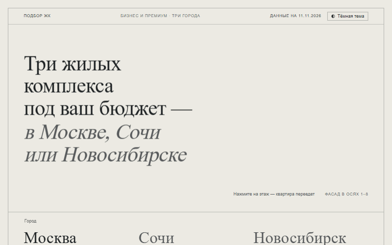

# Подбор ЖК

Три жилых комплекса под бюджет и площадь — в Москве, Сочи или Новосибирске.

Демо: https://podbor-zhk.svg-composer.workers.dev



Как это работает:
1. Выберите город — линия горизонта перерисуется.
2. Задайте бюджет и площадь ползунком или числом. План квартиры меняется в масштабе (клетка — 1 м), цифры докручиваются.
3. Ниже сразу три ЖК. Сначала самые дорогие из тех, что помещаются в бюджет. Если таких меньше трёх, добираются ближайшие сверх бюджета: на них стоит штриховка, процент превышения и подсказка, сколько добавить или до какой площади уменьшить.

Тема по умолчанию берётся из системы. Кнопка в шапке переключает светлую и тёмную, и браузер запоминает выбор.

Анимации (чертёж дома на первом экране, появление блоков, инерция прокрутки колесом мыши) отключаются системной настройкой «уменьшить движение».

Статический сайт без сборки: всё, что публикуется, лежит в `web/public/`.
Данные берутся только из `data.xlsx` (лист «Данные», строки 2–16).

## Обновить данные и передеплоить

Из корня проекта:

```bash
python web/build_data.py
```
Читает `data.xlsx` и пишет `web/public/data.json`. Если строк не 15, ЖК не по 5 на город, цена ≤ 0 или ссылка не `https://`, скрипт падает с понятной ошибкой. Нужен `openpyxl`.

```bash
node --test web/test/pick.test.mjs
```
Тест логики подбора на кейсах из ТЗ.

```bash
npx wrangler deploy --config web/wrangler.jsonc
```
Публикация на Cloudflare: Workers со статикой из `web/public`, без серверного кода. Перед первым деплоем нужно один раз войти: `npx wrangler login`.

## Посмотреть локально

```bash
python -m http.server 8765 --directory web/public
```
Если браузер ругается на MIME-тип `.js` (так бывает на Windows), используйте конфигурацию `podbor-zhk` из `.claude/launch.json`.

## Файлы

- `public/pick.js` — логика подбора: чистые функции без DOM.
- `public/app.js` — интерфейс: план квартиры, силуэты городов, карточки.
- `public/style.css` — токены цвета, светлая и тёмная тема.
- `screenshots/` — скриншоты проверки.
